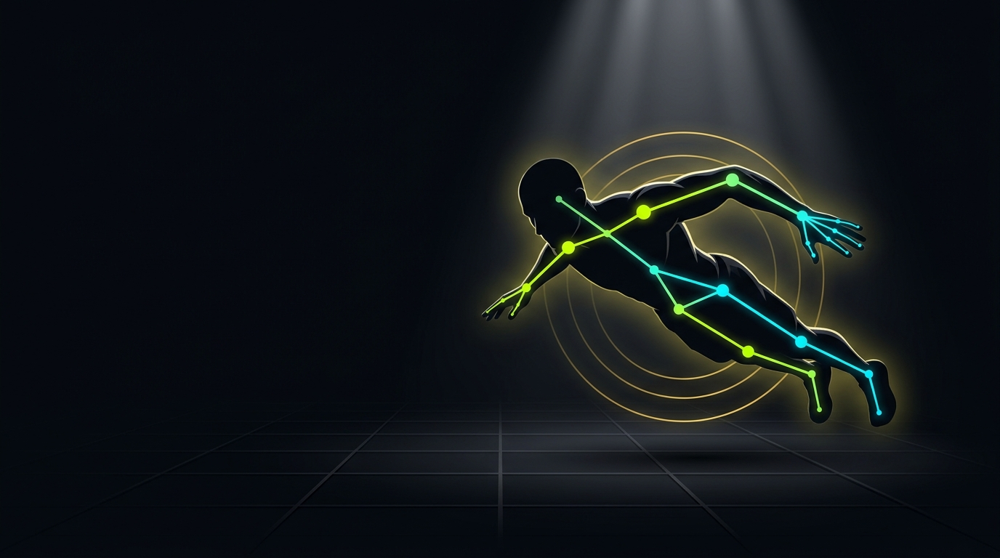

# PushUp Rank

Competitive Android fitness application powered by **Kotlin**, **Jetpack Compose (Material 3)**, **CameraX**, **Google ML Kit Pose Detection** (100% on-device), and **Cloud Firestore**.

## Repository Visual Assets

### PC / Desktop Banner (16:9)

### Mobile Showcase / Wallpaper (9:16)

  

## Key Features

- **On-Device AI Pose Tracking**: Real-time elbow angle (< 90° bottom / > 160° lockout) and back alignment validation via ML Kit Pose Detection running entirely in RAM.
- **Competitive Ranks & Arena**: Progression tiers (Bronze to Master), live Cloud Firestore global/friends leaderboards with cadence anti-cheat, and 1v1 Arena Duels.
- **Progress Analytics & Daily Streak**: Interactive Compose Canvas workout progression chart (Line & Bar modes) and consecutive-day streak tracking.
- **PushCoins & Cosmetic Shop**: Unlockable themes, skeleton visual effects, avatar frames, titles, and consumable session boosts.
- **Play Policy Compliance**: Explicit RAM-only camera consent, first-launch medical fitness disclaimer, and full in-app account/data deletion.
