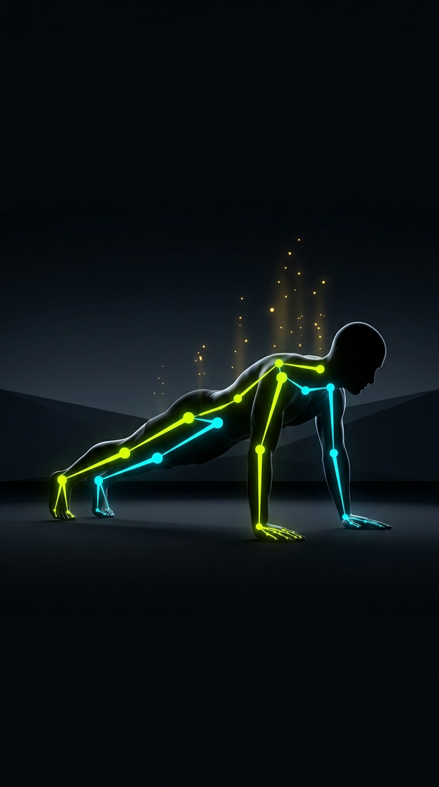

# PushUp Rank

Applicazione Android competitiva basata su **Kotlin**, **Jetpack Compose (Material 3)**, **CameraX**, **Google ML Kit Pose Detection** (100% on-device) e **Cloud Firestore**.

  

---

## Scarica e Installa su Telefono Android

1. Apri la scheda **Releases** (nella barra laterale destra del repository su desktop o dal menu del repository su smartphone).
2. Tocca **`PushUpRank-Android.apk`** per scaricare il file sul tuo telefono Android.
3. Apri l'`.apk` scaricato dalle notifiche o dall'app **File**, consenti l'installazione da origini sconosciute se richiesto e premi **Installa**.

---

## Configurazione Release per il Proprietario del Repository

Se la scheda **Releases** è ancora vuota (errore 404 su `/releases/latest`), pubblica prima la release con uno di questi due metodi:

- **Automatico (GitHub Actions)**: apri [`docs/release-assets.yml`](docs/release-assets.yml), copiane il contenuto e crea il file `.github/workflows/release-assets.yml` direttamente dal sito GitHub (**Add file → Create new file**), poi avvia il workflow dalla scheda **Actions**.
- **Manuale (30 secondi)**: esporta l'APK dal menu impostazioni di Google AI Studio (**Generate APK**), poi su GitHub vai su **Releases → Create a new release**, inserisci un tag (es. `v1.0.0`), allega il file `PushUpRank-Android.apk` e clicca **Publish release**.

---

## Funzionalità Principali

- **Rilevamento Flessioni AI On-Device**: calcolo angolo del gomito (< 90° discesa, > 160° risalita) e allineamento schiena con ML Kit Pose Detection elaborato esclusivamente in RAM.
- **Rank, Classifica & Arena 1v1**: livelli da Bronzo a Maestro, classifica globale e amici in tempo reale su Cloud Firestore con anti-cheat e duelli 1v1.
- **Grafico Progressi & Serie Giornaliera**: grafico interattivo Compose Canvas (Linee/Barre) e conteggio giorni consecutivi sul profilo.
- **PushCoin & Negozio In-App**: temi, effetti scheletro, cornici avatar, titoli e potenziamenti.
- **Conformità Google Play**: consenso esplicito fotocamera in RAM, disclaimer medico iniziale ed eliminazione completa account/dati.
